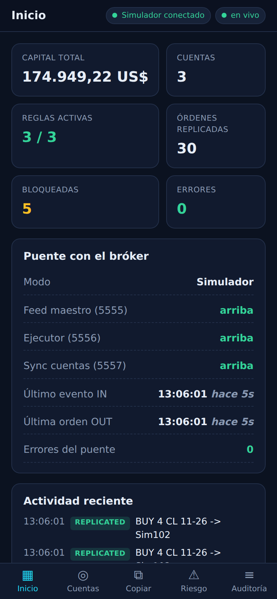
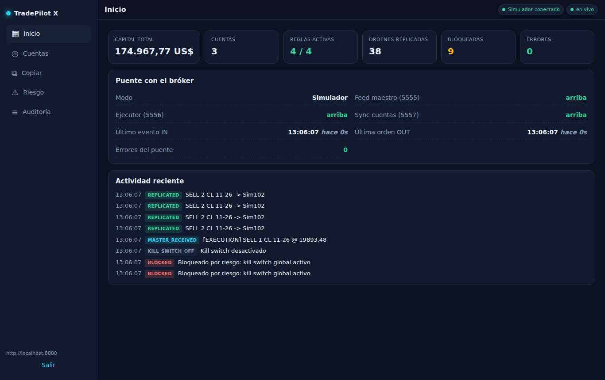

# TradePilot X

Replicador de órdenes para NinjaTrader con consola **web y móvil**. El motor corre junto a NinjaTrader; la consola se abre desde cualquier navegador o instalada como app en el teléfono.

Guía paso a paso (instalar, actualizar, operar, emergencias): [`docs/GUIA.md`](docs/GUIA.md). Diseño: [`docs/ARQUITECTURA.md`](docs/ARQUITECTURA.md). Cómo conseguir que todas las seguidoras entren al mismo precio y dónde se va el tiempo: [`docs/PLAN_MISMO_PRECIO.md`](docs/PLAN_MISMO_PRECIO.md). Plan de la plataforma central (guardar y analizar los trades de todos los usuarios y copiar a un líder a distancia): [`docs/PLAN_HUB.md`](docs/PLAN_HUB.md).

| Móvil | Escritorio |
|---|---|
|  |  |

## Arranque rápido (modo simulador, sin NinjaTrader)

```bash
# 1. Consola web
cd web && npm install && npm run build

# 2. Engine (sirve la API y la web en http://localhost:8000)
cd ../engine
pip install -e ".[dev]"
cp .env.example .env         # edita API_TOKEN
python -m tradepilot.main
```

Abre <http://localhost:8000>, pon la URL del engine y el token. En modo simulador, el botón **"Simular operación del maestro"** de la pestaña *Copiar* genera operaciones para ver el replicador trabajando.

## Actualizar a la última versión (Windows)

Con el engine parado (Ctrl+C en su ventana):

```powershell
cd $HOME\tradepilot
powershell -ExecutionPolicy Bypass -File scripts\update.ps1
```

Descarga los cambios, copia el addon actualizado a la carpeta de AddOns de NinjaTrader (con copia de seguridad del anterior) y arranca el engine. Si el addon cambió, compílalo en NinjaTrader (*New → NinjaScript Editor → F5*) y reinicia NinjaTrader.

## Probar desde el teléfono en local (misma Wi-Fi, sin dominio)

1. Arranca el engine en el PC. Al iniciar imprime algo como `Consola disponible en: http://localhost:8000 | http://192.168.1.40:8000`.
2. El puerto tiene que estar abierto en el firewall de Windows. `scripts/run_engine.ps1` crea la regla; si no, ejecútalo una vez como administrador o añádela a mano:
   ```powershell
   New-NetFirewallRule -DisplayName "TradePilot X" -Direction Inbound -Action Allow -Protocol TCP -LocalPort 8000
   ```
3. En el teléfono abre `http://<IP-del-PC>:8000`, deja esa URL en el campo *URL del engine* y pon el `API_TOKEN`.
4. Para tenerla como app: en Android, menú de Chrome → *Añadir a pantalla de inicio*; en iOS, botón compartir de Safari → *Añadir a pantalla de inicio*.

Avisos al teléfono (Telegram y notificaciones del navegador) e instalación paso a paso: `docs/GUIA.md` §3.

Nota: sobre `http://` con IP (sin HTTPS) el navegador no registra el *service worker*, así que el icono en el escritorio funciona como acceso directo a pantalla completa pero no hay instalación "oficial" ni caché offline. La app funciona igual; la instalación completa llega cuando se ponga HTTPS (túnel), más adelante.

## Publicar la consola (acceso desde cualquier sitio)

```powershell
scripts\publish.ps1                                              # prueba: URL aleatoria https://xxxx.trycloudflare.com + QR
scripts\publish.ps1 -Hostname consola.tudominio.com -Install     # dirección fija con tu dominio en Cloudflare, arranca sola
scripts\publish.ps1 -Uninstall
```

Túnel de Cloudflare: HTTPS, sin abrir puertos. El script genera un `API_TOKEN` fuerte si es el de ejemplo. Detalles en
`docs/GUIA.md` → "Acceder desde cualquier sitio".

## Arranque en Windows con un solo comando

Abre PowerShell en tu carpeta de usuario (no en `C:\WINDOWS\system32`):

```powershell
cd $HOME
git clone -b claude/eager-cannon-n4krnv https://github.com/Ifermin1/Ifermin1 tradepilot
cd tradepilot
powershell -ExecutionPolicy Bypass -File scripts\run_engine.ps1
```

El script crea el entorno virtual de Python, compila la consola web si falta (necesita Node.js), crea `engine\.env`, abre el puerto en el firewall y arranca el engine. Requisitos: Python 3.11+, Node.js 18+ y Git.

## Con NinjaTrader real (PC Windows)

En modo `mock` el engine **no está conectado a NinjaTrader**: las operaciones son inventadas y lo que abras en NinjaTrader no llega. Para replicar operaciones reales:

1. En `engine\.env` cambia `ENGINE_MODE=mock` por `ENGINE_MODE=ninja` (y los puertos ZMQ si no son 5555/5556/5557).
2. Abre NinjaTrader con el addon ZMQ de TradePilot activo (el mismo que usaba la versión de escritorio).
3. Ctrl+C en el engine y arráncalo de nuevo con `scripts\run_engine.ps1`. En el Inicio de la consola el puente debe decir **NinjaTrader (ZMQ)** y la pestaña *Cuentas* debe mostrar tus cuentas reales al cabo de unos segundos.
4. En *Cuentas*, enciende el interruptor de cada cuenta que deba copiar a la maestra. Con el addon actualizado (`ninjatrader/TradePilotXBridge.cs`, ver `ninjatrader/README.md`) se listan **todas** las cuentas que NinjaTrader conoce, conectadas o no; con *Gestionar cuentas* decides cuáles están activas y les pones alias. Con el addon antiguo solo se ven las conectadas.

Si *Cuentas* queda vacío, el addon no está respondiendo en 5557: revisa que NinjaTrader esté abierto y el addon cargado. Sin NinjaTrader a mano puedes probar el modo `ninja` con `python scripts\fake_ninja.py`, que imita el addon.
3. Acceso desde fuera de casa (túnel Cloudflare / Tailscale): fase posterior, ver `docs/ARQUITECTURA.md` §2.

## Protecciones

- **Grupos y presets**: etiquetas por cuenta (50K, PA…) con filtro y acciones en bloque, presets de riesgo (Conservador/Moderado/Agresivo, editables) y una tarjeta de *Recomendaciones* en Inicio con la acción de un clic (pausar, pasar a conservador, igualar, cerrar, poner perfil).
- **Seguridad**: PIN local en la consola (bloqueo por inactividad y antes de operar) y token de solo lectura (`API_READ_TOKEN`) para mirar sin poder operar.
- **Hub (opcional)**: servidor central `hub/` que reúne varios engines (operaciones, estado, avisos) con cola local y reintentos en cada engine; página y API de resumen de solo lectura.
- **Informe semanal y CSV**: informe imprimible (PDF desde el navegador) por cuenta, grupo o conjunto con resultado, por día e instrumento, retiros y pagos de la semana y reglas del coach; exportación CSV lista para Excel.
- **Móvil**: avisos push al teléfono con la consola cerrada (Web Push, sin Telegram), órdenes por Telegram (`/estado`, `/posiciones`, `/breakeven`, `/pausar`, `/reanudar`, `/cerrar` con confirmación) y vista de bolsillo `#pocket` con P&L, posiciones y los botones de cortar.
- **Coach IA**: revisión de cada sesión (qué costó dinero, tres reglas para mañana, nota de disciplina), semáforo de la orden antes de enviarla y chat con tus propios datos. Sin clave de IA funciona por reglas; con `ANTHROPIC_API_KEY` escribe Claude.
- **Red de seguridad automática**: perfil de prop firm aplicado solo a las cuentas nuevas (drawdown, colchón, tope de contratos), tope de contratos también en Operar, y pérdida máxima del día para el conjunto de cuentas que cierra todo y bloquea hasta mañana.
- **Cerrar todo**: en *Riesgo*, "Cerrar todas las seguidoras" o "Cerrar TODO (incluida la maestra)". El kill switch puede cerrar además de bloquear. En *Cuentas*, cada cuenta con posición tiene su botón *Cerrar*.
- **Desincronización**: si una seguidora no tiene la posición de la maestra × multiplicador durante más de 6 s, aparece en rojo como DESINCRONIZADA, solo se le copian salidas, y el botón *Igualar a la maestra* manda la diferencia a mercado.
- **Drawdown dinámico del prop firm**: el engine lleva el máximo que llegó a valer cada cuenta (con flotante, guardado entre reinicios) y el suelo que resulta de restarle el drawdown permitido. En *Riesgo* se ve para todas las cuentas; con *Drawdown máx.* configurado avisa al 80 % y pausa y cierra la cuenta cuando faltan los dólares del colchón, antes de que el prop firm la cierre.
- **Stop rechazado**: si el bróker rechaza un stop copiado, el engine cierra esa cuenta al instante (`CLOSE_ON_STOP_REJECT=true` en `.env`).
- **Diario**: `engine\data\journal\AAAA-MM-DD.jsonl` guarda todo lo recibido y enviado. Ante cualquier incidente, ese archivo es lo que hay que revisar.

Todo esto requiere el addon **v2.6** (el 2.5 y anteriores mandaban órdenes extra a mercado al saltar un stop y podían dejar la seguidora invertida); la consola avisa en rojo si el addon es anterior.

## Consola

- **Inicio** es la sala de control: barra de estado con el P&L del día y el botón DETENER, gráfico de P&L por cuenta (muestras cada 15 s), y un panel por cuenta en juego con su posición, sus **stops y take profits vivos** (con distancia al mercado) y su último fill o rechazo.
- **Vista compacta** (botón ▥) para ver más en el teléfono; en móvil la barra de estado queda fija sobre las pestañas.
- **Operar desde cualquier sitio** (pestaña *Operar*, addon ≥ 2.7): órdenes a mercado, límite, stop y stop límite en cualquier cuenta (en la maestra se replican), stop/objetivo automáticos con importes rápidos (100 en 100 $, puntos, ticks o múltiplos del riesgo), botón *Proteger* por posición (stop a breakeven, stop/objetivo rápidos con vista previa en dólares, **trailing stop** fijo, adaptativo por ATR y volumen, o decidido por la IA cada minuto), mover stop y objetivo con ▲▼, con el teclado o arrastrándolos en el gráfico de 1 minuto, plantillas de operación, OCO de entrada, trailing automático al ejecutarse, cierre parcial, modificar y cancelar órdenes vivas, cerrar una posición o toda la cuenta. Cada orden lleva un id único (reenviar nunca duplica), solo se da por aceptada cuando NinjaTrader la confirma, y la consola muestra las latencias consola↔engine↔NinjaTrader y bloquea las entradas sin conexión en vivo.
- **Calendario económico con IA**: pestaña *Noticias* (ForexFactory, se actualiza cada 5 min). Avisos en Inicio y Telegram 30 min antes de cada dato de EE. UU. con un análisis del impacto posible, y al publicarse el dato otro con el resultado y la reacción del precio (ticks del addon). Los hace Claude si pones `ANTHROPIC_API_KEY` en `engine\.env` (sin clave, análisis por reglas). Métricas: cómo te va operando en la noticia frente al resto, cuánto mueve cada dato y cuánto sorprende frente a la previsión.
- **Auditoría** con búsqueda, filtro por cuenta y por familia (copia, bloqueos, errores, riesgo, sistema); *Copiar* y *.txt* exportan lo filtrado.

## Problemas comunes

- **`Proactor event loop does not implement add_reader`** en Windows: versión antigua del engine. Haz `git pull`; el arranque actual fuerza el bucle de eventos que ZMQ necesita.
- **`Timeout sincronizando cuentas (5557)`** o *Cuentas* vacío: NinjaTrader no está abierto o el addon no está cargado (en NinjaTrader, *Tools → Output* debe mostrar `[TradePilotX] Bridge online`).
- **Banner "El engine rechazó el token guardado"**, `WebSocket 403` o `429 Too Many Requests`: el navegador guarda un token que ya no es el `API_TOKEN` del `engine\.env`. *Salir y volver a entrar* con el token actual (y reiniciar el engine si acabas de cambiar el `.env`).
- **`Failed to fetch`** en la pantalla de login: el engine no está arrancado. Comprueba que la ventana de PowerShell muestra `Uvicorn running`.

## Desarrollo

```bash
cd engine && python -m pytest          # pruebas del motor y la API
cd web && npm run dev                  # Vite con proxy a :8000 (hot reload)
```

Con Docker (solo modo simulador o con NinjaTrader accesible por red):

```bash
docker compose up --build
```
