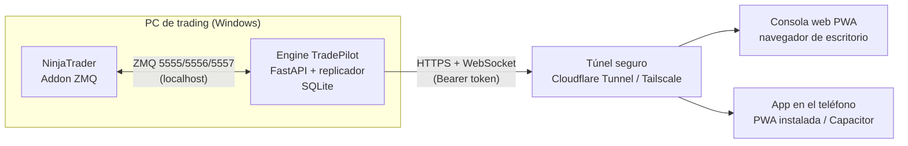

# TradePilot X — Reestructuración a web + móvil

## 1. De dónde venimos

La versión original (carpeta `legacy_flet/`) es una aplicación de escritorio en **Flet** (Python) que:

- Se conecta a **NinjaTrader** por **ZMQ** en `localhost` (5555 eventos del maestro, 5556 órdenes al ejecutor, 5557 sincronización de cuentas).
- Replica las operaciones de una cuenta maestra a cuentas seguidoras según reglas (multiplicador, filtro de símbolo).
- Guarda reglas y auditoría en SQLite.
- Dibuja la interfaz en el mismo proceso: solo se puede usar sentado delante de ese PC.

Problemas que arrastraba y que esta reestructuración corrige:

| Problema | Antes | Ahora |
|---|---|---|
| Solo accesible desde el PC de trading | UI Flet embebida en el proceso | UI web separada, accesible desde cualquier navegador o como app instalada en el teléfono |
| Bus interno sobre ZMQ loopback en el **puerto 5555**, el mismo que usa NinjaTrader para publicar | Choque de puertos / comportamiento errático | Bus de eventos en proceso (`core/events.py`), sin sockets |
| Imports relativos a la carpeta (`from bus.event_bus import bus`) | Solo funcionaba lanzando desde dentro de `tradepilot_x/` | Paquete instalable `tradepilot` con imports absolutos y `pyproject.toml` |
| Socket REQ que se quedaba bloqueado tras un timeout | Cuentas dejaban de sincronizar hasta reiniciar | El socket REQ se recrea tras timeout |
| SQLite abriendo una conexión por operación desde varias tareas | Riesgo de `database is locked` | Conexión única protegida por lock |
| Módulo de riesgo era un botón sin lógica | Kill switch decorativo | Kill switch real + límites por cuenta consultados antes de cada orden |
| Sin pruebas | — | 10 pruebas unitarias/API (`pytest`) y flujo end-to-end con Playwright |
| Nada versionado (un `.zip` con el `.venv` de Windows dentro) | — | Monorepo limpio, `.venv`/`node_modules` ignorados |

## 2. Principio de diseño: el motor vive junto a NinjaTrader, la consola vive donde tú estés

NinjaTrader solo habla ZMQ en `localhost`, así que **el motor de replicación tiene que seguir corriendo en ese PC Windows**. Lo que se saca fuera es la interfaz:



Componentes:

1. **`engine/`** (Python 3.11, FastAPI). Un solo proceso que:
   - Mantiene el puente con el bróker (`NinjaZmqBridge`) o un **simulador** (`MockBridge`) para desarrollar y hacer demos sin NinjaTrader.
   - Ejecuta el replicador y el módulo de riesgo.
   - Expone una **API REST** (`/api/...`) y un **WebSocket** (`/api/ws`) que empuja en tiempo real cuentas, salud del puente, auditoría y estado de riesgo.
   - Sirve la consola web compilada (`web/dist`) desde el mismo puerto, así solo hay que exponer **un** servicio.

2. **`web/`** (Vite + React + TypeScript, PWA). Interfaz *mobile-first*:
   - Barra de pestañas inferior en el teléfono, menú lateral en escritorio.
   - Instalable en iOS/Android desde el navegador ("Añadir a pantalla de inicio"), con icono y pantalla completa.
   - Recuerda la URL del engine y el token; reconecta el WebSocket sola.
   - La API nunca se cachea: siempre datos en vivo.

3. **Acceso remoto** (fase posterior; mientras se prueba, todo va por la Wi-Fi local con la IP del PC). El engine no debe abrirse a Internet directamente. Dos opciones, ambas sin abrir puertos en el router:
   - **Cloudflare Tunnel** (recomendado si quieres una URL tipo `https://tradepilot.tudominio.com` con HTTPS gratis y, opcionalmente, login de Cloudflare Access delante). `cloudflared tunnel --url http://localhost:8000`.
   - **Tailscale** (VPN privada; el teléfono y el PC quedan en la misma red virtual). Más simple, sin dominio, pero hay que instalar Tailscale en cada dispositivo.

   En ambos casos la API sigue exigiendo el `API_TOKEN`: es la segunda capa.

## 3. Estrategia móvil

| Fase | Qué | Esfuerzo | Estado |
|---|---|---|---|
| 1 | **PWA** instalable (lo que hay ahora) | Ya hecho | ✅ |
| 2 | **Notificaciones push** (Web Push desde el engine: límites, cierres, rechazos, caídas; abren la vista de bolsillo `#pocket`) + órdenes por Telegram | Hecho | ✅ |
| 3 | Empaquetar la misma web con **Capacitor** para publicar en App Store / Play Store si hace falta | Bajo-medio (no se reescribe nada) | opcional |

No hace falta una app nativa aparte: la PWA cubre el 90 % y Capacitor reutiliza el mismo código si en el futuro quieres tienda de apps.

## 4. Estructura del repositorio

```
engine/                     Motor Python (instalable, `pip install -e .`)
  tradepilot/
    core/       config, enums, bus de eventos, logging
    domain/     modelos Pydantic (cuentas, reglas, riesgo, auditoría)
    infrastructure/
      brokers/  base.py (contrato), ninja_zmq.py (real), mock.py (simulador)
      persistence/sqlite_store.py
    services/   account, replication, risk, audit
    api/        FastAPI: auth por token, rutas REST, WebSocket, servido del build web
    container.py  ensamblado de dependencias
    main.py       arranque uvicorn
  tests/                    pytest (dominio + API)
web/                        Consola PWA (Vite + React + TS)
  src/lib/      api.ts (cliente REST/WS), store.tsx (estado global + WS), format.ts
  src/pages/    Login, Dashboard (sala de control), Accounts, Replicator, Risk, Audit (filtros + exportación)
  src/components/ Shell (navegación + barra de estado), AccountPanel (posición, P&L en vivo, stops/TPs vivos),
                  PnlChart (SVG, paleta categórica validada, crosshair, tabla), ui
legacy_flet/                Código original de escritorio, solo referencia
docs/                       Este documento y capturas
scripts/                    Arranque en Windows
```

## 5. API

Todas las rutas requieren `Authorization: Bearer <API_TOKEN>` (o `?token=` en el WebSocket). Con `API_READ_TOKEN` (opcional)
el mismo esquema da un rol de **solo lectura**: pasan los GET y las consultas de IA (`/api/ai/review|check-entry|ask`); el
resto responde 403. `/api/health` devuelve `role` para que la consola se ponga en modo lectura.

| Método | Ruta | Descripción |
|---|---|---|
| GET | `/api/health` | Modo, salud del puente, estado de riesgo, contadores, rol del token y estado del vigilante (`watchdog`) |
| GET | `/api/accounts` | Cuentas sincronizadas |
| GET/POST | `/api/rules` | Listar / crear reglas |
| PATCH/DELETE | `/api/rules/{id}` | Editar (activar, multiplicador…) / borrar |
| GET | `/api/audit?limit=&event_type=` | Auditoría |
| GET | `/api/risk` | Kill switch + límites |
| POST | `/api/risk/kill-switch` | `{active, reason}` |
| PUT | `/api/risk/limits` | Límite por cuenta |
| POST | `/api/ai/review` | `{day, force}` revisión de la sesión (IA si hay clave, si no por reglas), cacheada por día |
| POST | `/api/ai/check-entry` | Semáforo de una orden: `{verdict: green|amber|red, reasons[]}` sin IA (ms); `ai: true` añade la opinión del modelo |
| POST | `/api/ai/ask` | Pregunta en lenguaje natural sobre las operaciones de los últimos N días (requiere clave de IA) |
| GET/POST | `/api/copilot` · `/api/copilot/run` · `/api/copilot/enabled` | Copiloto en vivo: propuestas por posición abierta (IA o reglas) |
| GET | `/api/metrics` · `/api/metrics/summary?hours=` | Prometheus (gauges, contadores, cuantiles) y resumen por hora/día para la pestaña Salud |
| GET | `/api/doctor` · `/api/diagnostics.zip` | Revisión de la instalación y zip de diagnóstico sin secretos (zip solo con token completo) |
| GET/POST | `/api/backup` · `/api/backup/run` · `/api/backup/download?name=` | Copias de la base (lista, integridad, copia ahora, descarga solo con token completo) |
| GET/POST | `/api/config/export` · `/api/config/import` | Configuración sin secretos, exportar e importar |
| GET/POST | `/api/reconcile` · `/api/reconcile/run` | Informe de reconciliación (órdenes a medias, posiciones sin stop, entradas pendientes, desincronización, trailing sin posición) |
| GET | `/api/trade/orders?limit=&today=` | Órdenes manuales guardadas (tabla `manual_orders`: idempotencia y estado que sobreviven a un reinicio) |
| GET/POST | `/api/hub` · `/api/hub/flush` | Estado del reporter del hub (cola, último envío) y envío forzado |
| GET | `/api/report/weekly?day=&account=&tag=&format=` | Informe semanal imprimible (HTML autocontenido) o JSON, por cuenta o grupo |
| GET | `/api/trades.csv?day_from=&day_to=&account=&tag=` | Operaciones en CSV (`;`, coma decimal, BOM) |
| GET | `/api/push` | Web Push: clave pública VAPID y dispositivos suscritos |
| POST | `/api/push/subscribe` · `/api/push/unsubscribe` · `/api/push/test` | Alta/baja de la suscripción del navegador y envío de prueba |
| POST | `/api/mock/master-event` | Solo modo mock: simular operación del maestro |
| WS | `/api/ws` | Eventos: `accounts.snapshot`, `broker.health`, `audit.event`, `risk.state` |

Documentación interactiva en `/docs` (Swagger) cuando el engine está arrancado.

## 6. Protecciones (nivel 1)

| Riesgo | Protección | Dónde |
|---|---|---|
| Posiciones abiertas en una emergencia | `FLATTEN` por cuenta y global ("Cerrar todo"); kill switch con opción "y cerrar seguidoras" | addon v1.5, `RiskService.flatten*`, pestañas *Cuentas* y *Riesgo* |
| Seguidora desincronizada sin que nadie avise | El addon reporta posiciones de todas las cuentas cada 2 s; `SyncService` compara con maestra × multiplicador y tras `DESYNC_GRACE_SECONDS` marca `DESYNC`: se bloquean copias que aumenten exposición y la consola ofrece "Igualar" | `sync_service.py`, *Cuentas* |
| Stop rechazado deja una posición sin protección | `CLOSE_ON_STOP_REJECT`: `FOLLOWER_REJECTED` de un stop dispara `NAKED_CLOSE` (cierre de esa cuenta) | `replication_service.py` → `risk.naked` → `RiskService._on_naked` |
| Reinicio del addon a mitad de operación | `RebuildState()` recupera las órdenes TPX vivas y las pendientes del master | addon v1.5 |
| Mensajes perdidos por ZMQ | Cada mensaje lleva `seq`; el engine audita `GAP` y `ADDON_RESTART` y las posiciones se reconcilian por sondeo. Un seq que llega unos mensajes tarde (el addon publica desde varios hilos) no es ni hueco ni reinicio: un hueco se espera 2 s antes de darlo por perdido | addon v1.5, `_check_seq` |
| Con muchas seguidoras las copias salen de una en una (16/9 15:18: 11 cuentas, la entrada tardó 1,6-3,1 s) | Todas las copias de un evento van en una petición `ORDERS\|` y el addon 2.5 las envía en paralelo; los 7 estados de tránsito de cada orden ya no se auditan (siguen en el diario) para no atascar el bucle del engine; `FOLLOWER_FILL` muestra la latencia real en el bróker (`en bróker N ms`, reloj de NinjaTrader) además de la del engine | `send_orders`, `_execute_many`, `LIFECYCLE_STATES` |
| El bróker llena una copia que ya había dado por cancelada (doble salida: 16/9 14:30, Sim102 corta 1 con la maestra plana) | Addon 2.4: recuerda lo ejecutado al reconciliar y la orden a mercado enviada; si la copia ejecuta más después, cancela la de mercado o deshace el exceso al instante. Engine (respaldo, `AUTO_FIX_OVERCLOSE`): una seguidora invertida o con posición sin maestra tras actividad del copiador, que persiste 2 s, se cierra a mercado (`OVERCLOSE_FIX`); nunca si el último fill fue manual | `SettleExcess` (addon), `SyncService._fix_overclose` |
| El stop de la maestra llena 1 de 2 y el addon manda "1 a mercado para seguirle" mientras el stop de la seguidora salta al mismo precio (17/9: 161 veces; seguidoras invertidas, `FIX-*` detrás, rechazos Rule #4304 por las órdenes extra) | Addon 2.6: la copia viva no se toca; el engine manda `master_filled_scaled` (lo ejecutado de esa orden del maestro, escalado) y el addon le da `ReconcileGraceMs` (750) para ejecutarse sola; solo si sigue viva sin llegar la cancela y manda la diferencia a mercado al confirmarse. Un stop recreado por `ORDER_MODIFIED` nunca cubre más de lo que las otras copias vivas dejan sin cubrir | `HandleFollowerMessage` (`EXECUTION_WAIT`), `CheckDeferredReconciles`, `LiveCopyCover`, `_order_kwargs` |
| El prop firm bloquea una cuenta a media sesión ("Order can be placed by administrators only") y se le sigue mandando cada copia | El engine la desactiva al primer rechazo de ese tipo (`ACCOUNT_LOCKED`) y deja de copiarle hasta que se active a mano | `ReplicationService._lock_account_if_needed` |
| Orden viva sin nada por ejecutar ("0 Sell STP") | El engine la audita una vez (`PHANTOM_ORDER`) y la consola la marca; el addon 2.4 cancela las copias TPX fantasma cada 5 s | `AccountService.apply_orders`, `SweepPhantoms` |
| Salta el stop/TP de una entrada que la seguidora no tiene (se bloqueó por tamaño) | El engine recuerda las órdenes pendientes del maestro; el fill de una que la seguidora no tiene copiada solo cierra lo que sus propios stops/TPs vivos no cubren, y el fill de su propio stop cuenta en vuelo hasta que el bróker lo refleja. Un cierre nunca va contra el signo de la posición (16/9 14:14: 173 quedó corta 3) | `_master_pending`, `_on_follower_fill` |
| ¿Entran todas al precio de la maestra? | `ReplicationService.executions`: por cada orden copiada, precio medio de la maestra y fill de cada seguidora con deslizamiento en ticks (`domain/symbols.py`), latencia y tiempo en bróker; `GET /api/execution`; `PUT /api/rules/entry` aplica el mismo modo de entrada a todas las seguidoras (`ENTRY_MODE_SET`). El simulador devuelve fills con 0-2 ticks y 80-300 ms para verlo sin NinjaTrader. Plan en `docs/PLAN_MISMO_PRECIO.md` | `_note_execution`, `_note_follower_fill`, `ExecutionQuality.tsx`, `MockBridge._ack_fill` |
| Historial de rendimiento (calendario) | `PerformanceService`: reconstruye cada operación cerrada a partir de los fills (posición por cuenta y raíz: entradas, salidas parciales, giros; P&L = puntos × valor del punto; comisiones estimadas) en la tabla `trades`, y guarda el P&L diario del bróker por cuenta en `daily_stats`; `GET /api/stats/month?month=AAAA-MM&account=` devuelve días (bróker o suma de operaciones, comisiones, aciertos) y operaciones. El simulador genera 45 días de demostración (`MOCK_DEMO_HISTORY`) | `performance_service.py`, `Performance.tsx` |
| Entrar desde cualquier sitio sin abrir el PC a Internet | `scripts/publish.ps1`: Cloudflare Tunnel rápido (trycloudflare) o con nombre (`-Hostname … -Install`, tarea programada), genera un token fuerte si hace falta y escribe `engine/data/public_url.txt`; el engine lo expone en `/api/health` (`public_url`, `token_weak`), sirve un QR (`/api/public-url/qr.svg`), frena la fuerza bruta por IP (10 fallos → 5 min, `AUTH_LOCKED`, IP real vía `CF-Connecting-IP`/`X-Forwarded-For`) y añade cabeceras de seguridad (HSTS tras HTTPS, nosniff, sin iframes). Consola: "Acceso remoto" con QR y aviso de token débil | `publish.ps1`, `api/auth.py`, `api/app.py`, `Shell.tsx` |
| Indicadores estadísticos y gráficas con una sola definición en toda la consola | `web/src/lib/stats.ts` (puro: tradeStats, dayStats, byHour/Weekday/Symbol/Account/Side, histogram) y `components/charts.tsx` (SVG: barras con signo, histograma, curva de capital con drawdown, sparkline, pop-ups). Los usan Análisis → Estadísticas y la tarjeta "Últimos 30 días" de Inicio | `Analysis.tsx` (StatsTab), `RecentStats.tsx` |
| Saber qué reglas tiene cada cuenta (prop firm, tipo de drawdown) sin memorizarlas | Perfil por cuenta (`firm`, `plan`, `plan_size` en la tabla `accounts`, `PATCH /api/accounts/{id}`) y catálogo de prop firms en la consola (`web/src/lib/propfirms.ts`: firma → plan → tamaño → drawdown y tipo, bloqueo del suelo, objetivo, pérdida diaria, contratos) que rellena `PUT /api/risk/limits`. Nuevo modo de drawdown `static` (suelo fijo = `drawdown_floor_cap`, sin marca de agua) además de `intraday` y `eod` | `ProfileEditor.tsx`, `AccountService._compute_drawdown` |
| Revisar la gestión operación por operación, los retiros y si el saldo cuadra (pestaña *Análisis*) | `PerformanceService.analysis`: operaciones del periodo, filas por día (historial, P&L del bróker, comisiones, saldo de cierre en `balance_daily` guardado en cada sincronización, retiros) y movimientos de caja anotados a mano (`cash_events`: retiro / depósito / ajuste con importe, recibido y estado); `GET /api/stats/analysis?day_from=&day_to=&account=`, `GET/POST/PATCH/DELETE /api/cash`, `GET/PUT /api/ui/analysis` (parámetros compartidos). La consola calcula duración, clasificación, referencia de pérdida, aporte de trades cortos, saldo esperado y la verificación diaria | `performance_service.py`, `Analysis.tsx` |
| Enterarse de un límite, un cierre o un addon caído sin estar mirando la consola | `NotifyService`: suscrito a la auditoría, manda por Telegram (Bot API, `httpx`) los tipos configurados, agrupados en 1,5 s y sin repetir el mismo aviso de la misma cuenta en 60 s; `GET/PUT /api/notifications`, `POST /api/notifications/test`, `POST /api/notifications/discover-chat` (lee `getUpdates` tras el `/start`). En la consola, además, notificaciones del navegador (`lib/notify.ts`) para los eventos importantes que llegan por WebSocket | `notify_service.py`, `NotifyCard.tsx` |
| Operar sin saber qué dato sale a las 8:30 | `NewsService`: descarga el calendario económico público de ForexFactory (esta semana y la siguiente, caché por descarga: si falta la semana siguiente no es error) cada `NEWS_REFRESH_SECONDS` (5 min) y lo sirve en `GET /api/news?days=&countries=&min_impact=` (con análisis y reacciones); pestaña *Noticias* del Calendario y "Noticias de hoy" en Inicio. En simulador, eventos de muestra | `news_service.py`, `NewsPanel.tsx` |
| Operar desde el teléfono sin perder dinero por un retraso | Pestaña *Operar* → `POST /api/trade/order|cancel|modify|close`, `GET /api/trade/status`. `TradeService` valida (cuenta activa, `MANUAL_MAX_QTY`, precios según tipo, kill switch y cuentas pausadas solo permiten cerrar, addon ≥ `MANUAL_ADDON_VERSION`), es **idempotente por `client_id`** (reenviar devuelve el mismo resultado; el addon también ignora ids repetidos), y solo responde "aceptada" cuando el addon confirma por el canal REQ/REP de órdenes (un reintento automático; si no, error "NO confirmada"). Addon v2.7: `MANUAL|json` (orden con nombre `TPM <id>`; en la maestra se publica y replica como cualquier orden; con `sl_ticks`/`tp_ticks` crea stop y objetivo OCO al ejecutarse), `CANCEL|cuenta|orderKey`, `MODIFY|cuenta|orderKey|qty|limit|stop`, y publica `MANUAL_STATUS` (aceptada/ejecutada/rechazada) → auditoría `MANUAL_*`. Latencias: `ping_ms` (engine↔addon, medido en cada PING), `last_order_ms` (orden manual), y la consola mide la ida y vuelta del WebSocket (`ping:<t>` → `pong`). La consola bloquea las entradas sin conexión en vivo (> 20 s sin datos) y marca NO CONFIRMADA a los 10 s sin respuesta, con botón de reenvío con el mismo id. En simulador, `MockBridge.manual_order` ejecuta a mercado al instante y deja límites/stops vivos | `trade_service.py`, `ninja_zmq.py`, `mock.py`, `TradePilotXBridge.cs`, `Trade.tsx` |
| Proteger una posición sin calcular nada | `POST /api/trade/protect` (`breakeven` + `be_offset_ticks`, o `sl_price` / `tp_price`; `last_price` para rechazar un stop que se dispararía al instante salvo `force`). `TradeService.protect` busca las salidas vivas de la posición (lado contrario: StopMarket/StopLimit = stop, Limit = objetivo), las modifica (en la maestra las copias siguen vía ORDER_MODIFIED) o las crea con `manual_order`; si crea las dos a la vez les pone `oco` (addon v2.8 lo pasa a `CreateOrder`). `sweep_orphans` (tras cada sincronización) cancela una salida creada por Proteger cuya posición ya no existe. Consola: `QuickAmount` (100 en 100 $ por contrato, puntos o ticks, 1R-3R, conversión con `POINT_VALUE`/`tickSize`) y `ProtectPanel` | `trade_service.py`, `TradeHelpers.tsx` |
| Manejar muchas cuentas por grupos | `AccountSnapshot.tags` (columna `accounts.tags`, JSON; `PATCH /api/accounts/{id}` con `tags`, `PUT /api/accounts/tags` en lote). Presets en kv `ui.risk_presets` (`GET/PUT /api/ui/risk-presets`, 422 si hay ids repetidos) y `POST /api/risk/preset` que funde el preset en el `RiskLimit` y actualiza la regla (`multiplier`, `entry_mode`). `AdvisorService.advise()` (`GET /api/advice`): reglas DESYNC, NO_LIMITS, DD_HIGH/CRITICAL, MULT_HIGH_DD, DAILY_LOSS_NEAR, GOAL_NEAR, LOSING_STREAK, CONSISTENCY, PAUSED, NO_RULE con acciones ejecutables desde `AdviceCard` | `advisor_service.py`, `routes.py`, `Accounts.tsx`, `AdviceCard.tsx`, `Risk.tsx` |
| Ninguna cuenta sin red | `AutoRiskService`: `AccountService.on_account_seen` (cuenta nueva o reactivada) → si el nombre delata la firma (`domain/propfirms.py`, espejo del catálogo de la consola) y no tiene límites, deduce el tamaño por el saldo y hace `risk.upsert_limit` + `accounts.set_settings(firm, plan, size)` (`AUTO_RISK_*`); `POST /api/risk/auto` lo aplica a mano (todas las activas sin límites, firma por defecto). `TradeService.validate` pasa por `risk.allows` (tope de contratos). `RiskService._check_day_loss`: pérdida neta conjunta ≥ `day_loss_limit` (kv) → kill switch + flatten de todas las cuentas activas con exposición, `DAY_CLOSED`; Reanudar marca `day_ack_day`. `PUT /api/risk/day-loss` | `auto_risk_service.py`, `propfirms.py`, `risk_service.py`, `Risk.tsx` |
| Operar con menos clics | Brackets en cualquier tipo de entrada (el addon los crea al fill). `POST /api/trade/oco` (`TradeService.place_oco`: dos patas con el mismo `oco`, validadas antes de mandar ninguna). `close_position(quantity)`: parcial ajusta las salidas a lo que queda; total las cancela. `place(... trail=...)` guarda un trailing pendiente que `apply_pending_trails` (tras cada sincronización) activa cuando existe la posición. Plantillas en kv `ui.trade_templates`. `GET /api/market/bars` → `CandleChart` (SVG) con líneas arrastrables que llaman a `/api/trade/protect` | `trade_service.py`, `routes.py`, `Trade.tsx`, `CandleChart.tsx` |
| Trailing stop que no haya que vigilar | `MarketService`: velas de 1 min (OHLCV) desde `TOPIC_PRICE` (el addon ≥ 2.9 manda `vol`), ATR, razón de volumen, máximos/mínimos. `TrailService` (bucle cada `TRAIL_INTERVAL_S`): por posición, modo `fixed` (distancia fija), `adaptive` (k × ATR acotado; −25 % con volumen ≥ 1,5×) o `ai` (cada `AI_TRAIL_INTERVAL_S` pregunta a Claude con las velas; el stop propuesto se acota entre el adaptativo y `min_ticks`; adaptativo como red); activación por beneficio, breakeven asegurado, paso mínimo, límite de 1 modificación/2 s; mueve el stop vivo con `modify_order` o lo crea con `manual_order`; `TRAIL_START/MOVE/END`; estado en kv `trail.active`. `POST/DELETE /api/trade/trail`, `GET /api/trade/trails`. Simulador: `MockBridge.emit_price` publica ticks cada segundo | `market_service.py`, `trail_service.py`, `TradeHelpers.tsx` (`TrailBox`) |
| Avisar de una noticia y analizarla | Bucle `NewsService.tick` cada minuto: `NEWS_SOON` (auditoría → Inicio y Telegram) cuando faltan < `NEWS_ALERT_MINUTES` para un evento vigilado (`NEWS_COUNTRIES`, `NEWS_MIN_IMPACT`) con el análisis previo; `NEWS_RESULT` cuando aparece `actual` (se espera 5 min si hay ticks para incluir la reacción). `AIService` pide a Claude (`ANTHROPIC_API_KEY`, `AI_MODEL`) un JSON con resumen, sesgo, movimiento esperado y consejo; sin clave o si falla, `heuristic_pre/post` (y se reintenta la IA hasta 3 veces). Reacción del precio: ticks `TOPIC_PRICE` (3 h en memoria) → precio antes y 5/15/30 min después, máximo/mínimo. Todo en SQLite (`news_events`, `news_analysis`, `news_reaction`); `GET /api/news/alerts`, `POST /api/news/analyze/{id}?kind=pre|post` | `news_service.py`, `ai_service.py`, `Dashboard.tsx` |
| Saber si me conviene operar en la noticia | `NewsService.stats(days)` → `GET /api/news/stats`: operaciones de `trades` dentro de ±15 min de un dato de impacto medio/alto frente al resto (n, neto, acierto, media, PF, por dato), reacción media del precio por impacto y datos que más mueven, sorpresas real/previsión por dato y si el precio siguió la sorpresa | `news_service.py`, `NewsPanel.tsx` (`NewsStats`) |
| Gestionar cientos de seguidoras sin perderse (quién copia, con qué multiplicador, corte, objetivo, drawdown, posición) | Pestaña *Cuentas* como una sola tabla: una fila por cuenta con estado, interruptor y multiplicador, P&L, barras de corte/objetivo/drawdown, posición y acciones; fila desplegable con el panel completo, prop firm y opciones de ejecución; acciones en lote sobre las marcadas; "Pausar toda la copia" = kill switch sin cerrar. La antigua pestaña *Copiar* (mapa) se eliminó: con cientos de cuentas era ilegible y duplicaba lo de Cuentas | `Accounts.tsx` |
| Diagnóstico de incidentes | Diario JSONL (`data/journal/AAAA-MM-DD.jsonl`) con cada mensaje recibido y cada orden enviada | `journal.py` |
| Addon desactualizado sin saberlo | `MIN_ADDON_VERSION`; aviso rojo en *Inicio* | `/api/health.addon_outdated` |
| No ver qué stops tiene realmente cada seguidora | `GET_ORDERS` cada 2 s (addon v2.2) → `AccountSnapshot.working_orders`; el panel por cuenta muestra stop/TP con distancia al último tick (`market.price`) | `account_service.apply_orders`, *Inicio* / *Cuentas* |
| El prop firm cierra la cuenta por drawdown dinámico | Marca de agua por cuenta (`account_peaks`: máximo con flotante y solo cerrado, persistente); `AccountSnapshot.drawdown` (máximo, suelo, margen, % consumido) en `/api/accounts` y WS; `RiskLimit.max_trailing_drawdown` + modo (dinámico con flotante, o EOD: el máximo solo sube con el balance al cierre, `DRAWDOWN_EOD_TIME`) + tope del suelo + colchón: `DRAWDOWN_WARNING` al 80 %, `DRAWDOWN_LIMIT` pausa y cierra al llegar al colchón; `PUT /api/accounts/{id}/peak` fija/reinicia el máximo | `account_service._track_drawdown`, `risk_service._check_drawdown`, *Riesgo* |
| Cómo va el día sin abrir NinjaTrader | Muestra de P&L por cuenta cada 15 s en SQLite (`pnl_samples`, 3 días) y `GET /api/pnl?hours=` para el gráfico | `account_service._sample_pnl`, `PnlChart` |

Nivel 2 (hecho): pérdida diaria máxima con el P&L real del addon (`DAILY_LOSS_WARNING` al 80 %, `DAILY_LOSS_LIMIT` pausa y
cierra; no se reanuda mientras el P&L siga por debajo), objetivo de ganancia diaria (`DAILY_PROFIT_WARNING` al 80 %, ambos
medidos en neto: `CommissionService` suma contratos × tarifa por lado en cada fill que ve el engine, `commissions_daily`,
`PUT /api/risk/commissions`;
`DAILY_PROFIT_TARGET` pausa y cierra para asegurar la ganancia; misma regla de reanudación), drawdown dinámico del prop firm
(`DRAWDOWN_WARNING` al 80 %, `DRAWDOWN_LIMIT` pausa y cierra antes del suelo; máximo persistente y ajustable), ventana horaria con cierre programado (`SCHEDULED_FLATTEN`, bloqueo
hasta el día siguiente, `reopen` manual), tamaño máximo de posición resultante, y vigilancia del heartbeat (`ADDON_SILENT`).
Nivel 3 (hecho): CI en GitHub (pytest, build y escenarios contra el addon simulado), arranque automático del engine
(tarea programada con reinicio), mapeo de símbolo por seguidora (`target_root`), entradas límite con tolerancia y plazo
(`entry_mode`, addon v1.7), autocuración del canal de eventos (`RESUBSCRIBE`): vigilante del heartbeat (15 s) y, con addon v1.8, comparación por
el canal de comandos (`PING` → `PONG|boot|seq`) que detecta en ~4 s un reinicio o eventos que no llegan; tras reconectar
se vuelve a pedir `WATCH` de cada seguidora (`ADDON_RECOVERY`). Desde el addon v1.9 las órdenes van por el canal de
comandos con confirmación (`ORDER|json` → `OK/IGNORED/ERROR`): una orden que el addon no confirma se reintenta una vez y,
si sigue sin respuesta, queda como `ERROR` en la auditoría en vez de darse por enviada.
Libro de exposición (addon v2.0): el engine cuenta las copias de fills en vuelo y las salidas vivas copiadas por seguidora;
un stop/TP solo se copia hasta la posición esperada (`BLOCKED`/`TRIMMED`), las cancelaciones pasan siempre, y un cierre
del maestro (`is_exit`) nunca abre ni invierte posición (`SKIPPED`/`TRIMMED`). Un cambio de orden rechazado ya no cuenta
como stop desnudo. En el addon, el fill del master con la copia aún viva se resuelve cancelando y cerrando a mercado.
El libro de salidas vivas se contrasta con las órdenes reales del bróker (`GET_ORDERS`): una salida copiada que lleva más
de 2 s y el bróker ya no tiene viva se purga, y una salida del lado contrario nunca cuenta (16/9 16:32-16:36: un stop de 1
fantasma recortó cada stop nuevo a 1 y las seguidoras quedaron cortas 1 tres veces). Un fill en vuelo solo se asienta
contra una foto de posiciones pedida después de recibirlo, y los fills parciales del maestro copian lo que la seguidora
aún deba (`_master_filled`) en vez de saltarse por "ya ejecutó su orden".
Avisos por Telegram: hechos (`NotifyService`).

## 6b. Hub (varios engines en un sitio)

Cada PC de trading sigue teniendo su engine junto a NinjaTrader (la copia nunca depende de Internet). Opcionalmente, cada
engine **empuja** al hub (`hub/`, FastAPI + SQLite, `hub/README.md`) sus operaciones cerradas, una foto de su estado y los
avisos importantes: `HubReporter` encola en `hub_outbox` y manda lotes a `POST /api/ingest` cada `HUB_INTERVAL_S`; si el
hub no responde la cola se conserva y se reintenta (tope 5000 elementos). El hub es solo lectura (fase 1): `GET /api/summary`
y una página mínima con el P&L del día de cada nodo, cuentas, kill switch, operaciones de la semana y últimos avisos. La
fase 2 (órdenes desde el hub, usuarios) queda abierta.

## 6b2. Addon 3.0: defensas propias

`MaxOrderQty` (tope duro por orden) y validación de esquema en `HandleFollowerMessage`/`HandleManual`; `NoteEngine()` anota
cada petición del engine y `CheckEngineSilence()` avisa en el Output a los `EngineSilentWarnS`; `CheckPoller()` (timer de
10 s) reconstruye los sockets si el `NetMQPoller` dejó de correr; `HEARTBEAT` añade `engine_silent_s`, `uptime_s`,
`restarts` y `PING` responde `PONG|boot|seq|version|silent`. El engine audita `ADDON_ALONE` y `ADDON_SELF_RESTART`.

## 6c. Pruebas: unitarias, propiedades, escenarios y caos

- `engine/tests`: unitarias y de API con el simulador (`ENGINE_MODE=mock`), más **tests de propiedades** (hypothesis) de la
  matemática de la copia (escalado por multiplicador, tope de contratos) y de las estadísticas.
- `scripts/ci_scenarios.py`: escenarios de protección contra `scripts/fake_ninja.py` (NinjaTrader falso por ZeroMQ, modo
  `ninja`): copia, bloqueo por tamaño, desincronización e igualado, límites, canal atascado, kill switch.
- `scripts/ci_chaos.py`: **caos**: fill duplicado, ráfaga de cinco fills, orden manual repetida, reinicio del addon
  (`REBOOT`), NinjaTrader colgado 25 s (`SLEEP`: modo degradado y vuelta con reconciliación) y el engine matado y
  arrancado de nuevo (idempotencia persistida, reconciliación de arranque, posiciones intactas).
- CI (`.github/workflows/ci.yml`): pytest en Linux **y en Windows**, build de la consola, escenarios y caos.

## 7. Próximos pasos sugeridos

1. **Probar con NinjaTrader real**: `ENGINE_MODE=ninja` en el PC de trading y verificar que el addon ZMQ sigue enviando el mismo JSON (el protocolo no ha cambiado).
2. **Túnel**: elegir Cloudflare Tunnel o Tailscale y probar la PWA desde el móvil con datos.
3. **Push**: hecho (Web Push + vista de bolsillo + órdenes por Telegram).
4. **P&L diario real**: NinjaTrader hoy solo devuelve balance por 5557; ampliar el addon para enviar P&L y posiciones abiertas y así activar el límite de pérdida diaria (ya está modelado en `RiskLimit.max_daily_loss`).
5. **Multiusuario / roles** si más de una persona va a operar la consola (hoy un solo token).
6. **Historial de ejecuciones** con confirmación del ejecutor (fills reales) además de la auditoría de envío.
